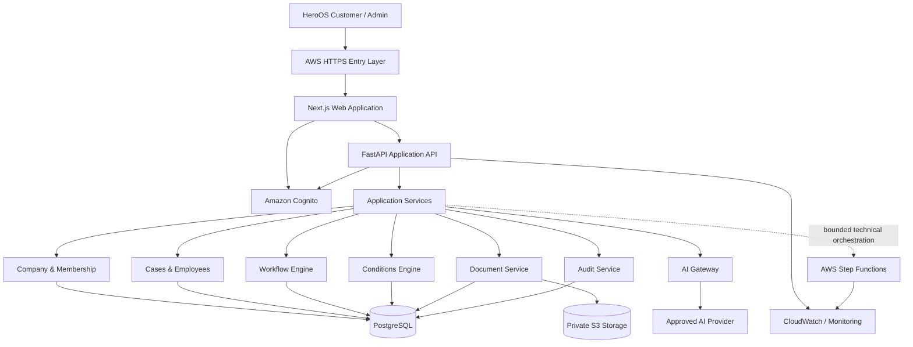

# HeroOS V1 System Architecture

**Status:** Draft architecture baseline  
**Owner:** Technical Lead  
**Milestone:** M1 — Foundation & Security  
**Issue:** M1-01 — Finalize V1 architecture & security baseline  
**Last updated:** 2026-10-08

## 1. Purpose

This document defines the technical architecture baseline for HeroOS V1.

HeroOS is a guided HR workflow platform for companies that need structured HR support without operating a full internal HR department.

V1 must support three end-to-end workflows:

1. Disciplinary
2. Probation
3. Recruitment

The architecture must allow these workflows to run on one reusable platform rather than as three separately hard-coded applications.

V1 initially supports:

- UAE Federal / MOHRE
- DIFC

ADGM is outside V1 scope.

---

## 2. Architectural Goals

The V1 architecture must provide:

- Strong company/tenant isolation
- Secure authentication and authorization
- Persistent HR cases and workflow state
- Versioned workflow definitions
- Deterministic Conditions
- Structured facts and human decisions
- Approved HR knowledge and Playbooks
- Controlled AI assistance
- Private document storage
- Auditable case history
- Safe escalation when HeroOS cannot continue
- Reproducible deployments
- Separate Development, Staging and Production environments
- Monitoring, backups and recovery foundations
- A reusable foundation for future HeroOS workflows

The architecture should remain simple enough to deliver and operate reliably during V1.

---

## 3. Core Architecture Principles

### 3.1 HeroOS is a workflow platform with an AI interface

AI improves the customer interaction, but it does not own the HR process.

The underlying workflow platform determines:

- workflow version
- current state
- valid transitions
- required facts
- applicable Conditions
- supported jurisdiction
- human decision requirements
- escalation requirements

AI may help interpret and communicate these concepts but may not replace them.

### 3.2 Backend services own authoritative business behavior

The browser is not a security or business-rule boundary.

Authoritative validation must occur in backend application services.

The backend is responsible for:

- authorization
- tenant validation
- workflow transitions
- Condition evaluation
- persistence
- audit recording
- document authorization
- AI output validation

### 3.3 PostgreSQL is the authoritative business-state store

HeroOS application services and PostgreSQL are the authoritative source of truth for:

- companies
- memberships
- employees / case subjects
- cases
- workflow instances
- workflow versions
- structured facts
- Condition evaluations
- human decisions
- document metadata
- audit events
- escalation state

AI provider state, browser state and AWS Step Functions execution state are not authoritative HeroOS business state.

### 3.4 AI is not the source of HR truth

AI may:

- interpret natural-language customer input
- extract proposed structured facts
- classify supported workflow intent
- identify missing information
- retrieve approved HeroOS content through controlled application services
- explain deterministic outcomes
- draft controlled content
- recognize when escalation may be required

AI must not:

- invent HR rules
- invent legal requirements
- override Conditions
- bypass workflow transitions
- make material employment decisions
- determine tenant authorization
- fabricate case state
- use unsupported jurisdiction guidance
- continue when required information or approved guidance is unavailable

### 3.5 Security must fail closed

When authorization, tenant context, workflow validity, jurisdiction or required information cannot be established safely, HeroOS must deny, block, ask for information or escalate rather than guess.

### 3.6 Privacy policy is not silently encoded by engineering

Technical security controls may be implemented directly.

Material business/privacy policies such as retention periods, deletion behavior, AI-provider processing and cross-border processing must be recorded in the Privacy & Security Decision Register when product or legal approval is required.

---

## 4. High-Level Architecture

